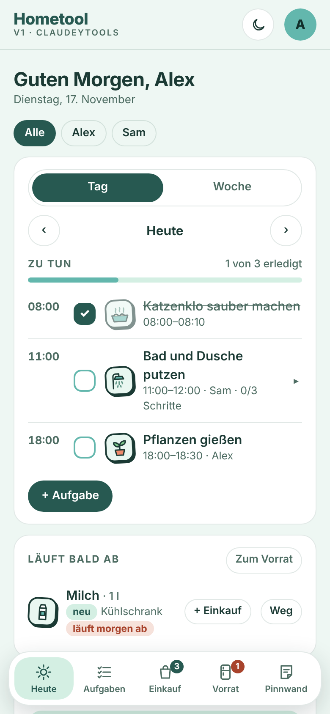
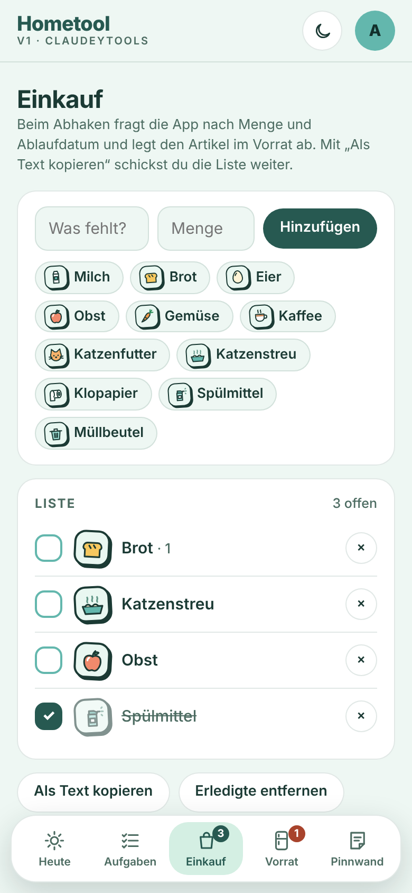
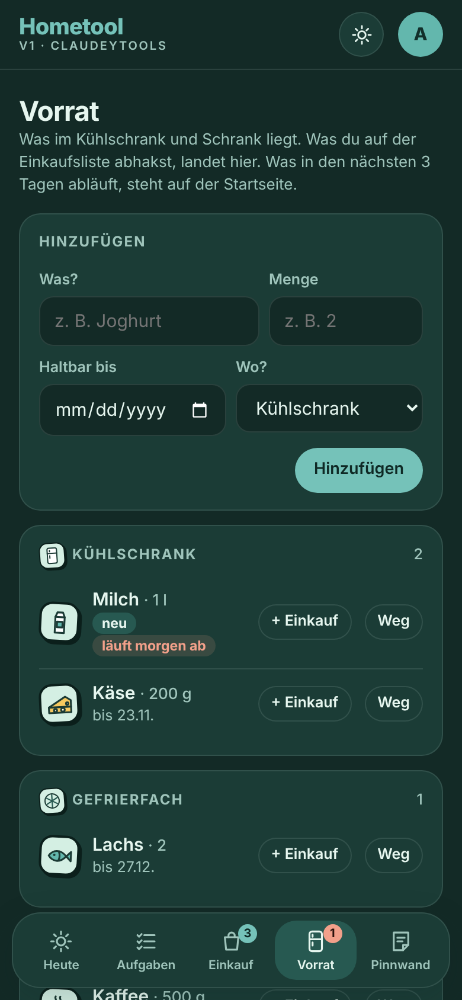
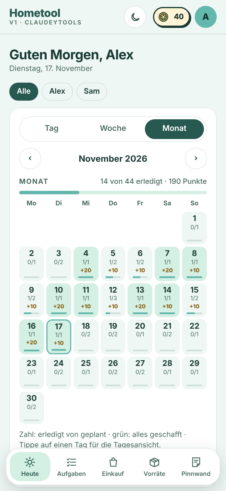
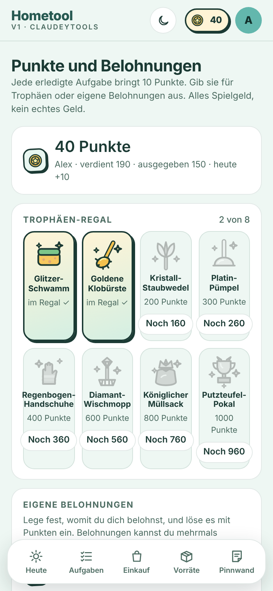

# Hometool

**Der kleine Haushaltsplaner für Zuhause, die WG oder das Büro.**
Wer putzt diese Woche das Bad? Was muss eingekauft werden? Läuft die Milch bald ab? Hometool behält es für dich im Blick, direkt im Browser, ohne Anmeldung und ohne Werbung. Und weil Putzen mehr Spaß macht, wenn es sich lohnt: Für jede erledigte Aufgabe gibt es Punkte, und mit 100 Punkten schaltest du die Goldene Klobürste frei.

### 👉 [App öffnen](https://DevNoartroom.github.io/hometool/)

  
  
  

  
  

---

## Was Hometool kann

- **Aufgaben, die sich selbst wiederholen:** täglich, an bestimmten Wochentagen, monatlich oder alle paar Tage. Mit Uhrzeit, Teilschritten (z. B. Bad: Dusche, WC, Spiegel) und der Person, die dran ist.
- **Kalender mit Tag, Woche und Monat** auf der Startseite: Du siehst sofort, was ansteht und was du schon geschafft hast.
- **Punkte sammeln:** 10 Punkte pro erledigter Aufgabe. Gib sie für Comic-Trophäen aus (vom Glitzer-Schwamm bis zum Putzteufel-Pokal) oder für eigene Belohnungen wie „Pizza bestellen“. Alles Spielgeld, kein echtes Geld.
- **Einkaufsliste:** Wenn du etwas abhakst, fragt die App kurz nach Menge und Ablaufdatum und legt es bei den Vorräten ab.
- **Vorräte** in Kühlschrank, Gefrierfach und Schrank: Die App warnt, wenn etwas in den nächsten 3 Tagen abläuft.
- **Verbrauch pro Woche und Monat:** Was hast du verbraucht, weggeworfen und gekauft? Gleiche Artikel werden zusammengezählt, z. B. „Milch · 3× gekauft · 3 l“.
- **Pinnwand** für Notizen an alle: „Vermieter kommt Donnerstag“, „WLAN-Passwort hängt am Kühlschrank“.
- **Kalender-Export** für iPhone, Google oder Outlook, auch nur für eine Person.
- **Hell und dunkel**, kleine Comic-Symbole, am Handy und am Computer nutzbar.

---

## In 1 Minute startklar

1. **[App öffnen](https://DevNoartroom.github.io/hometool/)**.
2. **Auf den Home-Bildschirm legen**, dann öffnet sie sich wie eine normale App:
   - **iPhone (Safari):** Teilen-Symbol ⬆️ → **Zum Home-Bildschirm**
   - **Android (Chrome):** Menü **⋮** → **Zum Startbildschirm hinzufügen**
3. **Profil anlegen:** Runden Knopf oben rechts antippen → **Anlegen** → Namen eintragen.
4. **Erste Aufgabe anlegen:** Auf der Startseite **+ Aufgabe** tippen. Oder **Beispiele laden** antippen und die Beispielaufgaben anpassen.

---

## Mit Mitbewohnern teilen

Hometool speichert alles nur auf deinem Gerät. Es gibt keinen Server, der eure Handys verbindet. Teilen geht über Dateien:

**Termine in den Kalender des anderen**
1. Runder Knopf oben rechts → **Kalender** → bei „Für wen?“ den Namen wählen.
2. **Kalender exportieren** tippen und die Datei z. B. per WhatsApp oder Signal schicken.
3. Der andere öffnet die Datei, und die Termine landen in seinem Kalender.

**Die ganze App teilen (Aufgaben, Haken, Punkte, Einkauf, Vorräte, Verbrauch, Pinnwand)**
1. Runder Knopf oben rechts → **Daten exportieren (JSON)** → Datei schicken.
2. Der andere öffnet *sein* Hometool → runder Knopf → **Daten importieren** → Datei wählen.
3. Fertig. Gleiche Einträge werden aktualisiert, nichts wird doppelt angelegt.

> Die Dateien zeigen den Stand von *jetzt*. Wenn sich etwas ändert, einfach neu exportieren und schicken.

---

## Häufige Fragen

**Wie hake ich etwas ab?**
Auf das Kästchen links neben der Aufgabe tippen. Hat die Aufgabe Teilschritte, tippe auf den Namen, dann kannst du jeden Schritt einzeln abhaken. Sind alle Schritte erledigt, ist die Aufgabe automatisch fertig.

**Wie ordne ich eine Aufgabe meinem Mitbewohner zu?**
Erst unter runder Knopf → **Personen** seinen Namen eintragen. Dann die Aufgabe öffnen (Reiter **Aufgaben** → **Alle Aufgaben** → **Bearbeiten**) und bei **Wer?** seinen Namen wählen.

**Wie ändere oder lösche ich eine Aufgabe?**
Reiter **Aufgaben** → **Alle Aufgaben** → **Bearbeiten**. Unten links im Fenster steht **Löschen**.

**Was heißt „jederzeit“?**
Das ist eine einmalige Aufgabe ohne Datum. Sie bleibt auf der Startseite, bis du sie abhakst.

**Was bedeuten die Farben bei den Vorräten?**
Rot heißt: läuft heute oder morgen ab oder ist schon abgelaufen. Gelb heißt: noch 2–3 Tage. **neu** heißt: in den letzten Tagen gekauft.

**Warum sieht mein Mitbewohner meine Haken nicht?**
Weil jedes Handy seine eigenen Daten hat. Schick ihm die Daten-Datei (siehe „Mit Mitbewohnern teilen“). Deine Haken sind darin enthalten.

**Ich habe die Termine neu exportiert, jetzt sind sie doppelt im Kalender.**
Manche Kalender-Apps legen beim erneuten Import neue Termine an. Lösch in dem Fall die alten Hometool-Termine und importiere die neue Datei.

**Ich bekomme ein neues Handy. Wie nehme ich meine Daten mit?**
Auf dem alten Handy **Daten exportieren**, die Datei aufs neue Handy schicken und dort **Daten importieren**.

**Was passiert, wenn ich den Browserverlauf lösche?**
Dann sind die Daten auf diesem Gerät weg. Exportiere darum ab und zu eine Sicherung. Die App erinnert dich, wenn die letzte älter als 30 Tage ist.

**Wie sehe ich, was ich im Monat verbraucht habe?**
Reiter **Vorräte** → **Verbrauch** → **Woche** oder **Monat**. Die Liste füllt sich von selbst: Tippst du bei einem Vorrat auf **Weg**, fragt die App „verbraucht oder weggeworfen?“. Alles, was du auf der Einkaufsliste abhakst, zählt als gekauft. Mengen mit gleicher Einheit werden addiert, also 2 l + 1 l = 3 l.

**Ich habe mich vertippt. Wie lösche ich einen Vorrat, ohne dass er im Verbrauch auftaucht?**
Auf den Namen tippen → **Löschen** (unten links).

**Wie funktionieren die Punkte?**
Jede erledigte Aufgabe bringt 10 Punkte. Nimmst du den Haken wieder weg, sind die Punkte auch wieder weg. Tippe oben auf die Münze mit deinem Punktestand: Dort kaufst du Trophäen für dein Regal oder legst eigene Belohnungen an und löst sie ein.

**Kann ich meine Belohnungen selbst festlegen?**
Ja. Münze oben → **Eigene Belohnungen** → Namen und Preis eintragen, z. B. „Serienabend – 150 Punkte“. Eigene Belohnungen kannst du beliebig oft einlösen, jede Trophäe gibt es einmal.

**Wie wechsle ich zwischen hell und dunkel?**
Mit dem Mond- bzw. Sonnen-Knopf oben rechts.

---

## Datenschutz in einem Satz

Alles bleibt in deinem Browser: kein Konto, kein Server, kein Tracking, und die App schickt nichts ins Internet. Trag trotzdem keine Passwörter, PINs oder Kontonummern ein. Details stehen in der [SECURITY.md](SECURITY.md).

---

Hometool v1 · eine einzige HTML-Datei, ohne Server.
Wie du Hometool selbst auf GitHub veröffentlichst und wie die Daten aufgebaut sind, steht in [docs/BETRIEB.md](docs/BETRIEB.md).
Noch keine Lizenz festgelegt.
