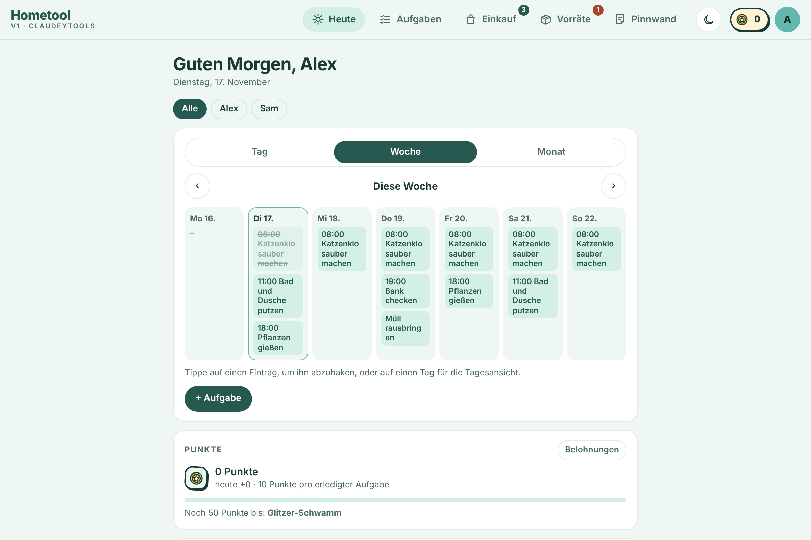

# Hometool v1

**Der kleine Haushaltsplaner für Zuhause, die WG oder das Büro.**
Aufgaben mit Wiederholung, Einkaufsliste, Vorrat mit Ablaufdatum, Pinnwand und Kalender-Export. Alles steckt in einer einzigen HTML-Datei. Sie läuft ohne Server, ohne Anmeldung und ohne Tracking.

<p>
  
  
  
</p>



> Die Screenshots zeigen erfundene Beispieldaten.

---

## Funktionen

| Bereich | Was es kann |
|---|---|
| **Heute** | Kalender mit Tag- und Wochenansicht, Fortschrittsbalken, überfällige Termine, „läuft bald ab“, die neuesten Notizen und die offene Einkaufsliste |
| **Aufgaben** | Selbst anlegen: einmalig, täglich, an Wochentagen, monatlich oder alle X Tage. Mit Uhrzeit, Dauer, Person, Teilschritten (z. B. Bad: Dusche, WC, Spiegel) und Notiz |
| **Einkauf** | Liste mit Menge und Schnellknöpfen. Beim Abhaken fragt die App nach Menge, Ablaufdatum und Ort und legt den Artikel im Vorrat ab |
| **Vorrat** | Kühlschrank, Gefrierfach und Vorratsschrank mit Ablaufdatum. Warnt 3 Tage vorher, mit einem Tipp kommt ein Artikel zurück auf die Einkaufsliste |
| **Pinnwand** | Notizen in vier Farben, mit Autor und Uhrzeit, zum Anheften. Sie sind im Daten-Export enthalten |
| **Profil** | Name und Farbe. Weitere Personen (z. B. Mitbewohner) lassen sich anlegen und Aufgaben zuordnen |
| **Kalender** | Export als `.ics` für iPhone, Google oder Outlook, auf Wunsch nur für eine Person und mit Ablaufdaten |
| **Teilen** | Export und Import als JSON. Gleiche Einträge werden beim Import aktualisiert, nicht verdoppelt |
| **Sonstiges** | Hell- und Dunkelmodus (folgt dem System), Comic-Icons für Produkte und Aufgaben, Bedienung per Tastatur, Backup-Erinnerung |

---

## Schnellstart (ohne Installation)

1. Lade die Datei `index.html` herunter.
2. Doppelklicke darauf. Sie öffnet sich im Browser, und die App läuft sofort.
3. Tippe oben rechts auf den runden Knopf und lege dein Profil an.
4. Optional: Auf der Startseite „Beispiele laden“ antippen, um Beispielaufgaben auszuprobieren.

Deine Daten bleiben in genau diesem Browser auf genau diesem Gerät.

---

## Auf GitHub Pages veröffentlichen

Mit GitHub Pages bekommst du einen Link wie `https://DEINNAME.github.io/hometool/`, den du am Handy öffnen und auf den Home-Bildschirm legen kannst.

### Variante A: nur im Browser (ohne Terminal)

1. Bei [github.com](https://github.com) anmelden, oben rechts auf **+** → **New repository** klicken.
2. Als Namen `hometool` eintragen, **Public** wählen und **Create repository** klicken.
3. Auf der leeren Seite auf **uploading an existing file** klicken.
4. `index.html`, `README.md`, `SECURITY.md` und den Ordner `docs` in das Fenster ziehen und unten auf **Commit changes** klicken.
5. Im Repository auf **Settings** → links **Pages** gehen.
6. Bei **Branch** `main` und `/ (root)` wählen, dann **Save** klicken.
7. Nach 1–2 Minuten steht oben auf der Seite der Link zu deiner App.

### Variante B: mit dem Terminal

Voraussetzung: [Git](https://git-scm.com) ist installiert und das leere Repository `hometool` existiert schon auf GitHub (Schritte 1–2 oben).

```bash
git clone https://github.com/DEINNAME/hometool.git   # lädt das (leere) Repository auf deinen Computer
cd hometool                                          # wechselt in den neuen Ordner
# jetzt index.html, README.md, SECURITY.md und docs/ in diesen Ordner kopieren
git add index.html README.md SECURITY.md docs        # merkt diese Dateien für den nächsten Speicherstand vor
git commit -m "Hometool v1"                          # speichert einen Stand mit dieser Beschreibung
git push                                             # lädt den Stand zu GitHub hoch
git tag v1.0                                         # markiert diesen Stand als Version 1.0
git push --tags                                      # lädt die Markierung zu GitHub hoch
```

Danach GitHub Pages wie in Variante A, Schritte 5–7, einschalten.

> **Tipp:** Mit dem Versions-Tag `v1.0` kannst du später jederzeit zu genau diesem Stand zurück, falls ein Update etwas kaputt macht.

### Auf den Home-Bildschirm legen

- **iPhone (Safari):** Link öffnen → Teilen-Symbol → **Zum Home-Bildschirm**.
- **Android (Chrome):** Link öffnen → Menü **⋮** → **Zum Startbildschirm hinzufügen**.

---

## Mit Mitbewohnern teilen

Hometool hat keinen Server. Darum gibt es keine automatische Synchronisation, sondern zwei Wege, Daten weiterzugeben.

**1. Kalender (.ics): Termine im Kalender des anderen**
1. Profil-Knopf → **Kalender** → bei „Für wen?“ die Person wählen.
2. **Kalender exportieren** tippen und die Datei z. B. per Messenger schicken.
3. Wer die Datei öffnet, bekommt die Termine in seinen Kalender.

**2. Daten (JSON): dieselbe App-Ansicht beim anderen**
1. Profil-Knopf → **Daten exportieren (JSON)**.
2. Datei schicken. Der andere öffnet *sein* Hometool → **Daten importieren**.
3. Danach hat er dieselben Aufgaben, dieselbe Einkaufsliste, denselben Vorrat und dieselbe Pinnwand.

Beide Dateien zeigen den Stand zum Zeitpunkt des Exports. Nach Änderungen also neu exportieren und schicken.

---

## Wo liegen die Daten?

- Im **Browser-Speicher (localStorage)** des Geräts, unter dem Schlüssel `home-v1`.
- Nichts wird ins Internet geschickt. Die App lädt keine fremden Skripte, Schriften oder Bilder.
- **Browserdaten löschen = App-Daten weg.** Exportiere darum regelmäßig eine Sicherung (Profil-Knopf → **Daten exportieren**). Die App erinnert dich, wenn das letzte Backup älter als 30 Tage ist.

Mehr zu Sicherheit und Datenschutz steht in der [SECURITY.md](SECURITY.md).

---

## Datenformat (JSON-Export)

```json
{
  "app": "claudeytools-home",
  "v": 1,
  "tasks":  [{ "id": "t…", "n": "Bad putzen", "p": "Sam", "r": "weekly", "days": [5],
               "start": "2026-11-17", "tm": "11:00", "du": 60, "steps": ["Dusche", "WC"], "note": "" }],
  "shop":   [{ "id": "s…", "n": "Brot", "q": "1", "x": 0 }],
  "food":   [{ "id": "f…", "n": "Milch", "q": "1 l", "exp": "2026-11-20", "o": "Kühlschrank", "b": "2026-11-17" }],
  "notes":  [{ "id": "n…", "t": "Vermieter kommt Do 10 Uhr", "a": "Alex", "d": "2026-11-17T09:12", "c": "#d4efe3", "pin": 1 }],
  "people": ["Alex", "Sam"],
  "done":   { "t…|2026-11-17": 1 }
}
```

- `r` (Wiederholung): `once` (mit `date`, leer = jederzeit), `daily`, `weekly` (`days`: 0 = Montag … 6 = Sonntag), `monthly` (`md`: 1–28, 0 = letzter Tag), `interval` (`iv`: alle X Tage ab `start`)
- Wochentage zählen ab Montag, Datumsangaben im Format `JJJJ-MM-TT`.

---

## Grenzen von Version 1

- Keine Live-Synchronisation zwischen Geräten. Dafür bräuchte es einen Server, z. B. PocketBase.
- Abgehakte Aufgaben erscheinen nicht im exportierten Kalender, weil `.ics` keinen Erledigt-Status kennt.
- In manchen eingebetteten Vorschauen (z. B. in Chat-Apps) sind Downloads gesperrt. In einem normalen Browser oder über GitHub Pages funktionieren sie.

---

## Technik

- Eine Datei, reines HTML, CSS und JavaScript, ohne Frameworks und ohne Build-Schritt
- Icons sind eigene SVG-Zeichnungen, keine Emoji-Schrift und keine Bilddateien
- Farbpalette: `#d4efe3` `#9ddbd2` `#75c2b9` `#63b7ad` `#76b8a9` `#275951` `#629788` `#7d9c9c` `#4d6c62` `#4e6c6c`

---

## Lizenz

Noch keine Lizenz festgelegt. Ohne Lizenz dürfen andere den Code ansehen, aber nicht weiterverwenden. Wenn du das erlauben möchtest, kannst du auf GitHub über **Add file → Create new file → `LICENSE`** eine Vorlage auswählen (z. B. MIT).
